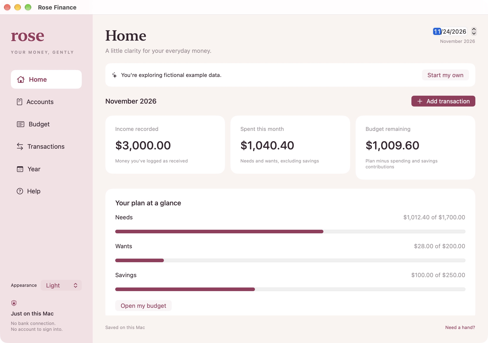
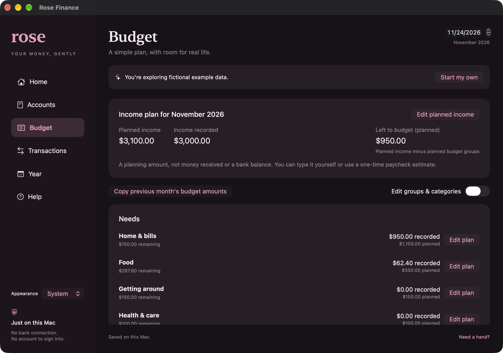
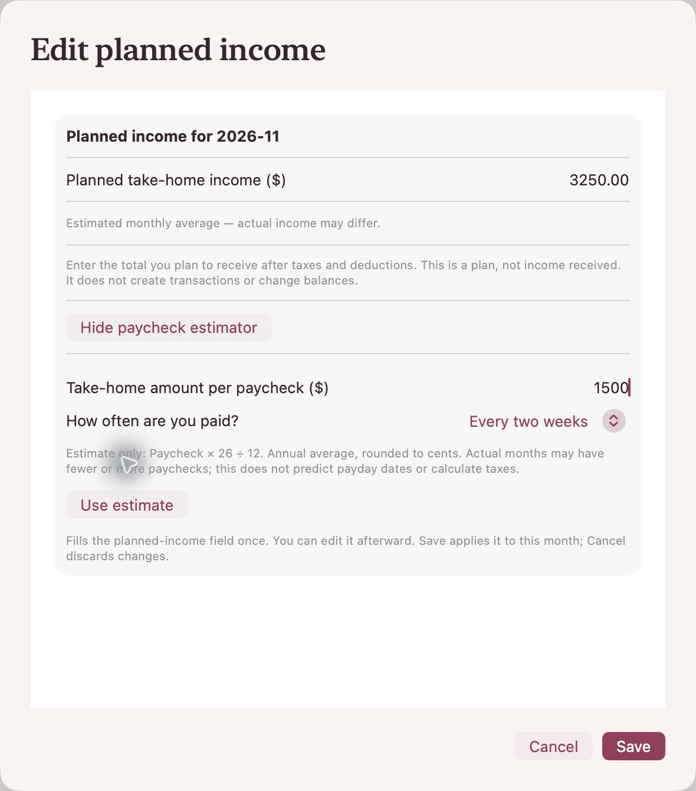

# Rose Finance 🌷

Rose is a simple, offline Mac app for keeping track of account balances,
planning a budget, and recording transactions. No bank login, subscription,
or server to keep running. Just your money, on your Mac.

## How this started

My own finance setup started as a spreadsheet and grew into a personal dashboard
with investment calculations and a bunch of features specific to me. When I
wanted to make a version for my partner, bringing all of that along felt
like a lot of dashboard just to log groceries.

So we started fresh: editable accounts, broad budget groups with more detailed
transaction categories underneath, monthly and yearly summaries, clear
directions, and a calm pink interface. Rose is its own native Mac app with
fictional starter data. It doesn't include my personal financial records or
connect to the original dashboard.

## Yes, it's vibe coded

This is a **vibe-coded app**, built with **OpenAI Codex** using **6.1 Sol**
with **High reasoning**. I brought the idea, chose the features, and worked
through the behavior with the coding agent. The code, tests, packaging, and
documentation were developed through prompts and iteration. All in all it
took about 20 minutes.

That model credit describes how the app was made. You don't need an AI account
or API key to use Rose, and the app doesn't send your finances to an AI service.
It's a personal project and an early preview, shared in case someone else finds
this simpler setup useful too.

## Download the Mac app

**[Download Rose Finance for Mac](https://github.com/ajvalentino/rose-finance/releases/latest/download/Rose-Finance-Mac.zip)**

1. Download the ZIP and double-click it to unzip.
2. Drag **Rose Finance.app** into Applications.
3. Open Rose Finance from Applications.

No Git, compiler, or Terminal is needed for this download. Requires macOS 13 or
later, on Apple Silicon or Intel. See [Releases](https://github.com/ajvalentino/rose-finance/releases)
for version details. Financial data stays on your Mac when you replace the app
with a newer version; this preview does not update automatically.

## See it before downloading

Real app screenshots using **fictional demo data**. No personal financial
records are shown. Click an image to view it full size.

### Overview in light mode



### Budget in dark mode

Planned income stays clearly separate from income recorded in transactions.



### Optional paycheck estimate

A take-home paycheck and pay frequency fill a planned amount once. The result
is labeled as an estimate, remains editable, and only saves when you choose Save.



## Open a locally built app

The built app is `dist/Rose Finance.app`. Double-click it, or copy it to
Applications first. Share `dist/Rose-Finance-Mac.zip` to move the application.
It bundles its executable and uses Apple's system frameworks: no Python, Docker,
browser, account, or network service is required. The universal build targets
Apple Silicon and Intel Macs with macOS 13 or later. Intel is cross-compiled,
not runtime-tested on this Apple Silicon development machine.

This is a locally ad-hoc-signed preview, not an Apple-notarized distribution.
Another Mac may require approval in System Settings → Privacy & Security to
open it. Do not disable Gatekeeper. Developer ID signing/notarization is a
remaining distribution step if this should install without that friction.

## What is included

- Home, editable Accounts, monthly Budget, Transactions, Year, and Help.
- Light and dark mode, with a remembered Appearance choice in the sidebar.
  System follows your Mac by default.
- Needs / Wants / Savings → broad budget groups → detailed categories.
- Monthly **Planned income**, kept separate from **Income recorded**, with an
  optional one-time take-home paycheck estimator and planned money left to budget.
- Positive income, spending, and savings-contribution entries in USD.
- Editable names, amounts, dates, notes, category mapping, and archival state.
- Fictional initial balances, a small sample month, and an explicit example reset
  that retains the category structure but removes accounts and financial amounts.
- Atomic file saves, automatic pre-change backups, export, and validated restore.
- Yearly and monthly totals without additional entry or vendor matching.

Balances are manual snapshots. Transactions never change them. Savings
contributions are separate from spending but use part of the budget.
Budget remaining = planned group amounts minus recorded spending and savings.
It is not a bank balance or an estimate of cash available.

Renames preserve identity. Transactions snapshot their original budget group and
Needs/Wants/Savings type. Category moves affect future entries unless the user
explicitly selects “Move existing transactions too.” Changing a group's type
preserves the classification of historical entries; budgets use the group's
current type. This can make a past Home type summary compare a current plan
classification to historical transaction classifications. Group-level totals
remain linked by stable group IDs. Archive instead of deleting structural items.

## Planning income

In Budget, choose **Edit planned income**. Type your monthly take-home total,
or expand **Calculate an estimate for me**, enter one take-home paycheck and
choose how often it arrives. **Use estimate** fills the planned-income field
once; **Save** applies it to that month. It never tracks or updates paychecks
automatically, and you can edit the filled value before saving or later.
Cancel discards the editor's changes.

The estimator uses annual monthly averages, rounded to the nearest cent:
weekly × 52 ÷ 12; every two weeks × 26 ÷ 12; twice a month × 2; monthly as entered.
These follow the [FDIC Money Smart monthly conversion convention](https://catalog.fdic.gov/catalog/sfc/servlet.shepherd/version/download/068t000000bhAKqAAM).
Results are labeled **Estimated monthly average**. Actual months can have fewer
or more paychecks, and variable pay will differ. Enter take-home pay: no tax
calculation, payday calendar, or guaranteed income is implied.

**Left to budget (planned)** subtracts all planned Needs, Wants, and Savings
from Planned income. It is not money received or available in a bank account.
Recorded income still comes only from transactions. Copying the previous
month's budget amounts leaves Planned income unchanged.

## Data and portability

Working data: `~/Library/Application Support/Rose Finance/Finance.json`.
Automatic backups: the adjacent `Backups/` folder, one before every change.
Backups currently accumulate; no automatic deletion policy is applied.

Version 0.1.3 reads older version-1 backups with no planned income set.
New saves/backups use schema version 2; use 0.1.3 or newer to open them. Older
app versions reject version-2 files rather than silently dropping income plans.
Automatic backups preserve the previous file before each save.

The app and data are separate. Replacing the `.app` keeps existing data. On
another Mac, open the app, then Help → Restore backup and select an exported
JSON backup. Restore checks the schema and references before replacing the
working file and keeps a recovery copy first. Backups are unencrypted financial
data; use a private storage location. Local automatic backups do not protect
against losing the Mac itself.

For development isolation, `COMPANION_DATA_DIR` selects another data directory.
Do not point it at the original dashboard's data folder.

## Development

From this directory, with Apple's Command Line Tools installed:

```sh
./test.sh
./build.sh
```

`Sources/Model.swift` holds the independent Codable ledger and persistence.
`Sources/App.swift` holds the app, screens, file dialogs, and help.
`Sources/Editor.swift` holds editing forms and validation.
`Tests/ModelTests.swift` exercises financial rollups, historical mapping,
validation, sample reset, and persistence/restore failures using temporary data.

## Get updates with Git

Clone this repository into its own folder on the Mac. The first build requires
Apple's Command Line Tools (the compiler); running the built app does not.
From the cloned folder:

```sh
./test.sh
./build.sh
open "dist/Rose Finance.app"
```

For later updates, quit Rose Finance, then run:

```sh
git pull --ff-only
./test.sh
./build.sh
open "dist/Rose Finance.app"
```

Run the newly built copy, or replace the old app in Applications. Your financial
data lives in Application Support and is not part of the Git checkout. Pulling
code does not synchronize, upload, or replace your financial records. The
repository includes fictional sample values only. Build output, backups,
financial-data files, and private development notes are excluded from Git.

## First-version boundaries

No bank sync, cloud hosting, cross-device sync, refunds, savings withdrawals,
recurring transactions, credit cards, investments, CSV import, or category merge.
For now, correct a refunded purchase by editing its original record; there is
no separate refund ledger. Group types are the three fixed fundamental buckets;
group/category/account names and mappings are editable. No password or custom
encryption is added; the app uses the Mac user's storage and permissions.
